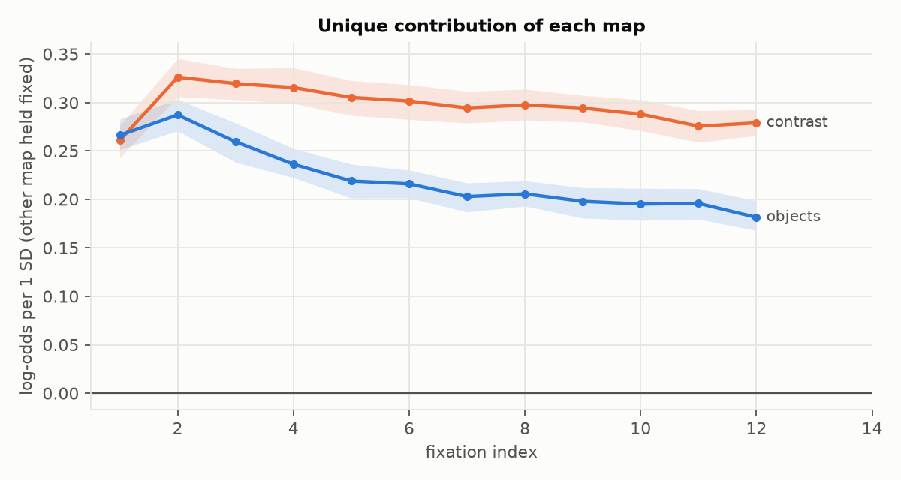

# What drives gaze over time? An exploratory look at COCO-FreeView

In 5 seconds of free viewing, are early fixations better explained by low-level feature contrast, and later
ones by objects? This repo scores every fixation in COCO-FreeView against three maps (an empirical center-bias
map, a simple feature-contrast map, and COCO object masks) and tracks how their predictive power changes with
fixation index. Every effect is reported against a shuffled-image control, so center bias isn't mistaken for
image-specific guidance.

This is exploratory. The feature-contrast map is a transparent low-level baseline, not a model of V1.

## Main result
Across **4,317 images and 10 observers**, a simple low-level feature-contrast map and COCO object masks each
predicted fixated locations beyond centre bias and beyond each other. Their unique contributions were equal at
the first fixation. Afterwards, contrast's contribution stayed nearly constant (0.33 → 0.28 log-odds per SD),
while objects' declined by about a third (0.29 → 0.18). The pattern was robust to how feature channels were
combined and to excluding images dominated by a single object, and appeared in 8 of 10 observers.



| figure | what it shows |
|---|---|
| [Image-specific guidance (NSS)](figures/20_nss_by_index_max.png) | object and contrast NSS minus the shuffled control, by fixation index |
| [Per-subject check](figures/22_per_subject_max.png) | object advantage over contrast for each observer |
| [Robustness: no object-dominated images](figures/21_joint_regression_max_maxobj0.5.png) | joint regression with `MAX_OBJ_FRAC = 0.5` |
| [Robustness: mean channel combination](figures/21_joint_regression_mean.png) | joint regression with `COMBINE = "mean"` |

### Limitations
- The contrast map is a transparent low-level baseline, not a model of V1 or of any specific theory.
- COCO labels 80 categories only. Unlabelled things people look at (text, papers, signs, object parts) count
  as background, so a drift of gaze toward such details would look like declining object guidance.
- Later fixation indices come only from scanpaths long enough to reach them, i.e. from observers who made more,
  shorter fixations. Part of the change over time may reflect this composition, not viewing time itself. Restricting
  every index to the same set of scanpaths would test this.
- Ten observers: the per-subject check is descriptive, not a population-level test.

## Analyses
1. **Object hits by fixation index**: the share of fixations on an annotated object, versus a shuffled control
   and versus object area (chance), plus a breakdown by COCO supercategory.
2. **NSS by fixation index** for the center, contrast and object maps, raw and as own − shuffled.
   - **2b · Joint regression**: per fixation index, a logistic regression of fixated vs. control locations on
     both maps, showing whether each still predicts gaze once the other is accounted for.
   - **2c · Per-subject check**: the object-over-contrast advantage for each of the 10 observers.
3. **Saccade amplitude and fixation duration** by fixation index. Durations exclude each scanpath's last
   fixation, which the 5-second trial end cuts short.

All confidence intervals resample images, not fixations.

## Robustness
Re-run the notebook with one setting changed in the setup cell. Figures are tagged so runs don't overwrite each
other.

| run | setting | tests |
|---|---|---|
| main | `N_IMAGES = 0` | all images |
| A | `MAX_OBJ_FRAC = 0.5` | whether images dominated by one large object drive the result |
| B | `COMBINE = "mean"` | whether the contrast result depends on how feature channels are combined |

## Data (not included)
The dataset terms forbid redistributing COCO-FreeView, so download it yourself into `data/`:

| file | where |
|---|---|
| `data/COCOFreeView_fixations_trainval.json` | [COCO-FreeView page](https://sites.google.com/view/cocosearch/coco-freeview) → training and validation set |
| `data/stimuli/…` (any sub-folders) | [COCO-Search18 page](https://sites.google.com/view/cocosearch/) → TP **and** TA image stimuli (1680×1050) |
| `data/annotations/instances_train2017.json`, `instances_val2017.json` | [COCO 2017 annotations](https://cocodataset.org/#download) → *2017 Train/Val annotations* |

Use the train/validation fixations only; the test fixations are withheld for benchmarking.

## Run
```bash
pip install -r requirements.txt
jupyter lab analysis.ipynb
```
`N_IMAGES` in the setup cell defaults to 800 for a quick first pass; set it to `0` for all images.
Scored fixations are cached in `cache/`, and figures are saved to `figures/`.

Before reading any result, check the two sanity cells: whether fixation 0 is the central start dot, and
whether the object outlines sit on the objects in the alignment overlay.

## Smoke test
`tests/make_synthetic.py` writes a tiny fake dataset in the same formats, with a planted effect: early
fixations go to a high-contrast pop-out object. The notebook should recover it.
```bash
python tests/make_synthetic.py /tmp/fv_synth
FV_DATA_DIR=/tmp/fv_synth FV_N_IMAGES=0 jupyter nbconvert --to notebook --execute analysis.ipynb --output /tmp/fv_synth/out.ipynb
```

## Files
- `analysis.ipynb`: the analysis, with sanity checks and write-up prompts
- `fvtools.py`: loading, stimulus alignment, maps, NSS and image-level bootstrap
- `tests/make_synthetic.py`: synthetic data generator for the smoke test

## References
- Chen, Y., Yang, Z., Chakraborty, S., Mondal, S., Ahn, S., Samaras, D., Hoai, M., & Zelinsky, G. (2022).
  Characterizing Target-Absent Human Attention. *CVPR Workshops*, 5031–5040.
- Li, Z. (2002). A saliency map in primary visual cortex. *Trends in Cognitive Sciences*, 6(1), 9–16.
- Itti, L., Koch, C., & Niebur, E. (1998). A model of saliency-based visual attention for rapid scene analysis.
  *IEEE TPAMI*, 20(11), 1254–1259.
